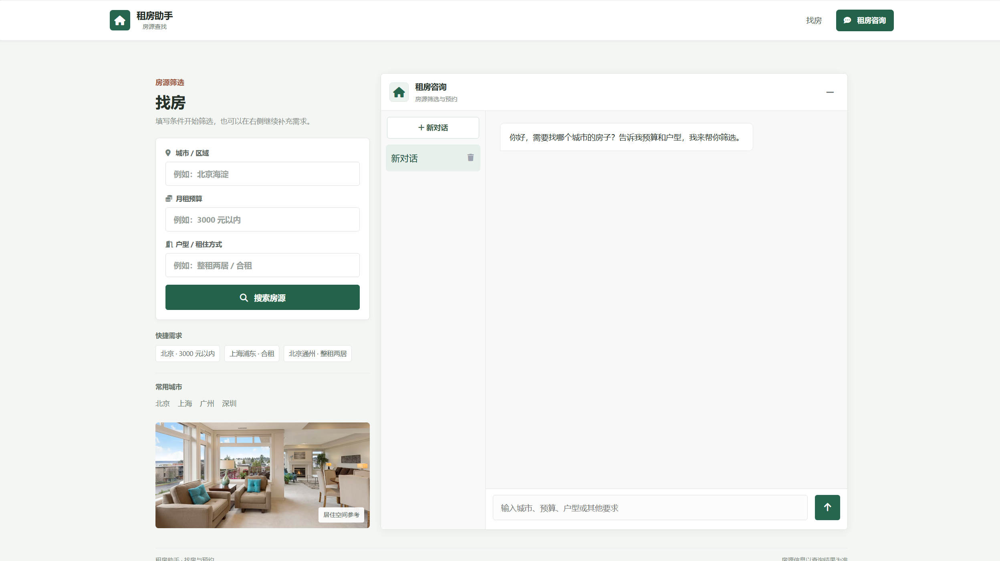
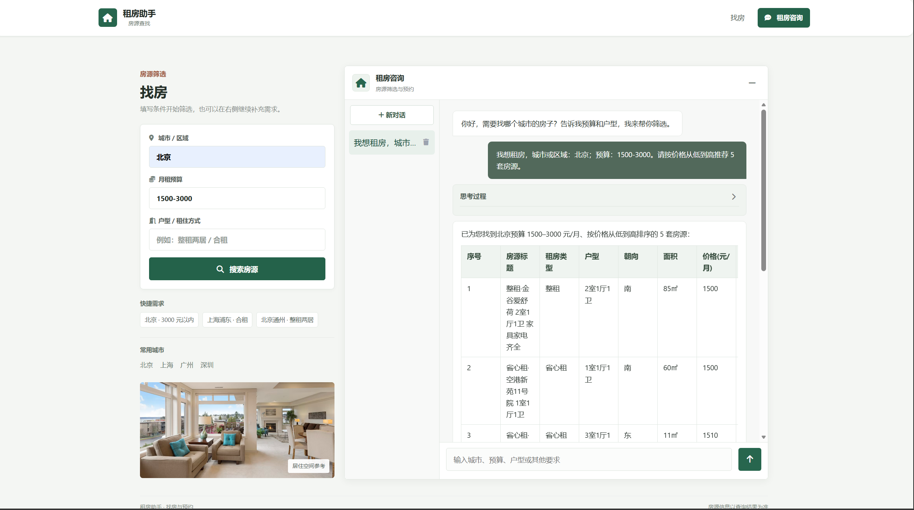
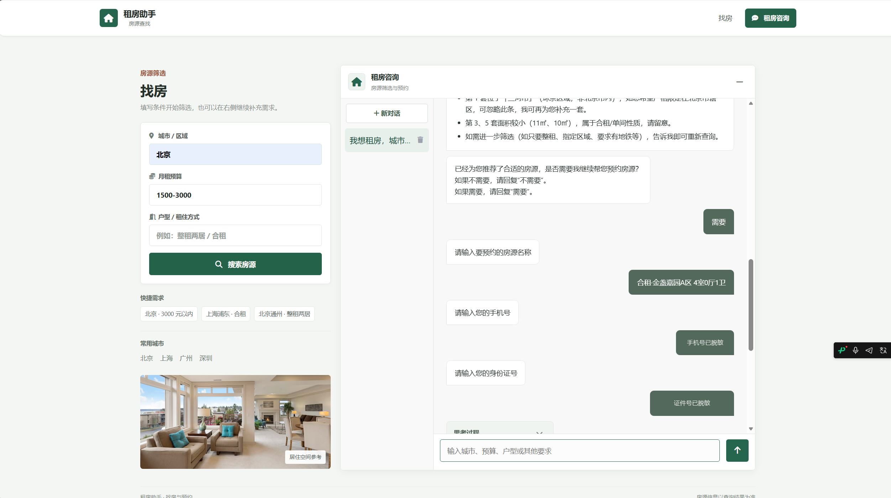
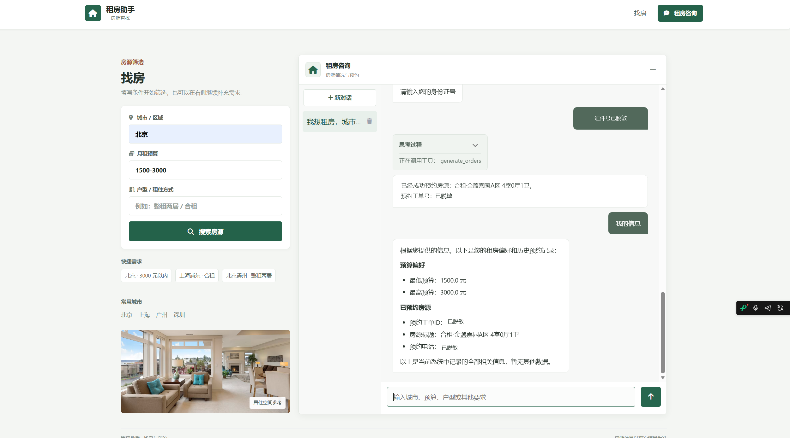
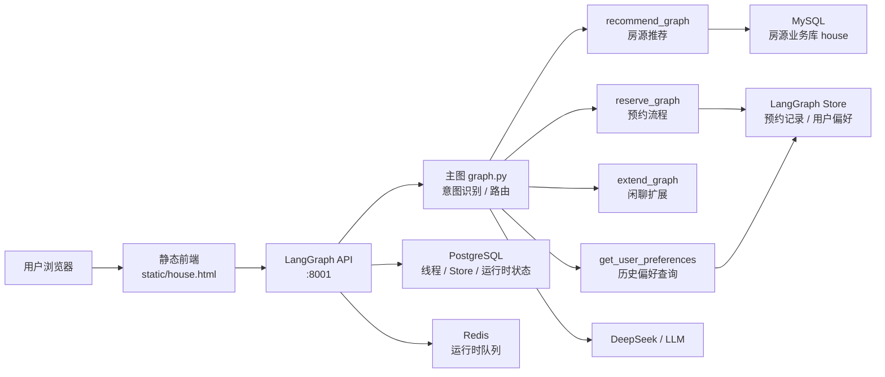

# House Agent

基于 LangGraph 的租房智能助手。项目对外是一个统一聊天入口，对内通过主图路由到多个业务子图，完成房源推荐、预约房源、历史偏好查询和闲聊扩展。

这个项目重点不是简单调用大模型回答问题，而是把租房业务拆成可控的 Agent 工作流：主图负责意图识别和路由，子图负责具体业务流程，状态由 LangGraph 统一管理。

## 在线演示

- 页面展示：[http://124.222.39.126:5500/static/house.html](http://124.222.39.126:5500/static/house.html)

## 功能亮点

- 自然语言找房：用户可以直接输入城市、预算、户型、区域、通勤等需求。
- 多轮信息补全：缺少城市或预算时，通过 LangGraph `interrupt` 暂停流程，等待用户补充后继续同一条工作流。
- SQL 房源检索：模型根据用户需求生成 SQL 查询，从真实 MySQL 房源库中检索数据。
- 推荐结果总结：把数据库结果整理成可读的推荐理由，而不是直接把表格结果丢给用户。
- 预约流程：用户确认预约后，继续收集房源名称、手机号、身份证号，并生成预约记录。
- 历史偏好复用：通过 LangGraph Store 保存用户预算偏好和预约记录，支持后续查询和推荐参考。
- 前端演示页：`static/house.html` 提供可直接演示的聊天界面，支持多对话、新建对话、删除对话和流式输出。
- Docker Compose 部署：后端、前端、LangGraph Postgres、Redis 可一键启动；业务 MySQL 独立连接。

## 项目截图

### 对话首页与多会话管理



前端提供聊天入口和多会话管理，支持新建对话、切换历史对话和删除对话。

### 房源推荐结果



用户输入租房需求后，推荐子图根据城市、预算、户型等条件查询房源库，并生成推荐结果。

### 预约信息收集



用户确认预约后，预约子图逐步收集房源名称、手机号等必要信息，缺失字段会继续追问。

### 预约成功与历史偏好



信息完整后系统调用预约工具生成工单，并可查询用户历史偏好和预约记录。

## 技术栈

- Python 
- LangGraph
- LangChain
- DeepSeek Chat Model
- MySQL：房源业务数据
- PostgreSQL：LangGraph 运行时状态、线程和 Store 持久化
- Redis：LangGraph 运行时队列
- Nginx：前端静态页面服务
- Docker Compose：云服务器部署

## 系统架构



核心文件：

```text
src/agent/graph.py              主图：意图识别和子图路由
src/agent/recommend.py          推荐子图流程
src/agent/reserve.py            预约子图流程
src/agent/extend.py             闲聊/扩展子图
src/agent/node/main.py          主图节点
src/agent/node/recommend.py     推荐节点：信息抽取、SQL 查询、推荐生成
src/agent/node/reserve.py       预约节点：字段收集、房源校验、预约工单生成
src/agent/state/*.py            LangGraph 状态定义
static/house.html               前端演示页面
```

## 核心流程

### 1. 房源推荐

用户输入租房需求后，主图将请求路由到 `recommend_graph`：

1. 抽取城市、预算、区域、户型、朝向、推荐数量等字段。
2. 如果缺少关键字段，通过 `interrupt` 追问用户。
3. 信息完整后生成 SQL 查询。
4. 调用数据库工具查询 MySQL 房源库。
5. 将查询结果整理成自然语言推荐。
6. 推荐完成后询问用户是否需要预约。

### 2. 预约房源

当用户回复“需要预约”后，主图进入 `reserve_graph`：

1. 校验用户要预约的房源是否来自当前会话推荐结果。
2. 收集手机号、身份证号等必要信息。
3. 信息缺失时通过 `interrupt` 逐项追问。
4. 生成预约工单。
5. 清空本轮预约状态，避免重复下单。

### 3. 历史偏好查询

用户询问“我之前预约过哪些房子”“我的预算偏好是多少”时，主图路由到 `get_user_preferences`，从 LangGraph Store 中读取预算偏好和预约记录，并组织回答。

## 本地运行

本地推荐使用 PyCharm 运行 `start_house_agent.py`。脚本会启动 Docker Compose 服务、检查前后端及 Nginx API 代理，并在 PyCharm 的 Run 窗口持续显示后端接口日志。

### 1. 准备环境

- 安装并启动 Docker Desktop。
- 使用 Python 3.12 创建或选择项目虚拟环境。
- 将 `.env.example` 复制为 `.env`，填写 DeepSeek Key、MySQL 密码和 PostgreSQL 密码。
- 如需使用本地 MySQL 房源数据，将数据库导出文件放在项目根目录并命名为 `house-mysql.sql`。该文件已排除在 Git 外，不要上传到 GitHub。

```powershell
Copy-Item .env.example .env
```

首次启动时，本地 MySQL 会从 `house-mysql.sql` 初始化空数据卷；已有数据卷不会重复导入。

### 2. 在 PyCharm 启动

将 Run Configuration 的 Script path 设为 `start_house_agent.py`，然后运行。也可以在项目终端执行：

```powershell
python start_house_agent.py
```

脚本会复用已有的前后端镜像；修改后端或 Dockerfile 后，添加 `--build` 强制重新构建：

```powershell
python start_house_agent.py --build
```

前端地址：

```text
http://127.0.0.1:5500/
```

API 文档可通过 Nginx 代理访问 `http://127.0.0.1:5500/api/docs`。PyCharm Run 窗口关闭日志跟随或按 `Ctrl+C` 只会停止查看日志，Docker 容器仍会继续运行。

## Docker Compose 部署

默认 Compose 服务：

- `house-backend`：LangGraph 后端，仅绑定服务器本机的 `127.0.0.1:8001`
- `house-frontend`：Nginx 前端，端口 `5500`，并将 `/api/` 请求代理到后端
- `house-postgres`：LangGraph 状态和 Store 持久化，宿主机端口 `5433`
- `house-redis`：LangGraph 队列，宿主机端口 `6380`

本地额外配置 `docker-compose.local.yml` 会启动 `house-mysql` 并连接本地房源库。服务器上的房源 MySQL 可使用 `.env` 中配置的现有数据库。

部署步骤：

```bash
cp .env.example .env
nano .env
bash deploy.sh
```

在线演示地址：

前端：[http://124.222.39.126:5500/static/house.html](http://124.222.39.126:5500/static/house.html)

更多说明见 [DEPLOY.md](DEPLOY.md)。

## 工程优化

- 将租房推荐、预约和历史偏好查询拆分为独立子图，降低单个提示词和单条链路的复杂度。
- 使用 `interrupt / command.resume` 处理缺失信息补全，避免多轮对话中状态丢失。
- 前端支持多会话管理，用户可以新建、切换和删除对话。
- 对推荐结果、预约追问和工具调用过程做了前端展示区分，减少多轮交互中的信息覆盖。
- 通过 Docker Compose 编排前端、后端、PostgreSQL 和 Redis，便于云服务器部署和演示。

## 项目设计亮点

- 这是“单入口、多子图编排”的 Agent 系统，而不是一个简单聊天机器人。
- 主图只负责意图识别和路由，推荐、预约、查询、闲聊拆成独立子图，职责清晰。
- 使用 LangGraph State 管理多轮对话中的城市、预算、预约字段和用户历史偏好。
- 使用 `interrupt / command.resume` 实现表单式信息补全。
- 推荐结果来自数据库查询，模型负责生成 SQL 和总结推荐理由，不是凭空编造房源。
- 前端处理了流式输出、工具调用过程、预约追问、多对话管理等真实工程问题。

## 注意事项

- 当前部署方式适合课程项目展示和个人作品集演示，不建议直接作为生产服务长期裸露公网。
- 公网通常只需开放前端端口 `5500`。后端 `8001` 绑定在服务器本机；PostgreSQL `5433` 和 Redis `6380` 若不需要远程管理，应通过安全组或防火墙限制访问。
- `.env`、日志、压缩包、虚拟环境、IDE 配置都已通过 `.gitignore` 排除。
